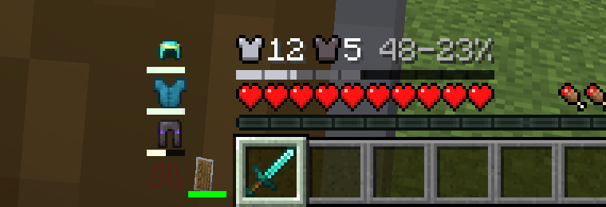
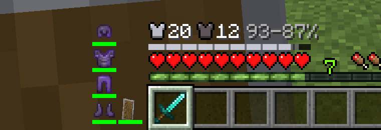

# Armor HUD

Vanilla's armor bar is ten chestplates that tell you one number. This one tells you what you are wearing, and what it actually does when you get hit.


Client-side only. Nothing needs to be installed on the server. Needs Fabric API; Pandorical (15.0.0 or later) is optional, and puts the settings in its mod menu.

## Beside the hotbar

Your armor, as itself: the helmet, chestplate, leggings and boots you are wearing, stacked head to foot to the left of the hotbar. The icons are the real items, so a dyed chestplate is its dye, a trim shows its pattern, and an enchanted piece shimmers.

Under each icon is the durability bar you know from the inventory: green when the piece is whole, through yellow, to red. When a piece gets low, the empty part of its bar flashes, so you hear about your boots before they break rather than after. A piece that never wears, like a carved pumpkin, is a full green bar.

When a piece takes a hit, its icon shakes and its bar flashes white. When one breaks, its empty slot flashes red.



An empty slot shows the inventory's faint outline for it, so a missing helmet looks missing. An elytra gets a bar like any chestplate, even though it gives no armor, because its durability is the one you most need to watch.

A shield in your offhand joins them, beside your boots, with its own durability bar: it wears in a fight like armor does, so it is watched like armor. Vanilla's offhand slot goes away while it does, and the stack closes up against the hotbar. Anything else in your offhand keeps vanilla's slot, and the stack leaves room for it.

## Above the hearts

Where vanilla's row of chestplates was: your armor points, your toughness, and a bar laid over your hearts that shows what they are worth.

The bar is ten hearts long, notched at every heart, and it answers one question: take a hit that would empty a full health bar, and how many hearts do you keep? The solid part is those hearts. Past it, a paler run is the extra you keep from light hits, because armor stops a bigger share of a smaller hit. Toughness is what makes the solid part catch up to the pale one: with no toughness a big hit punches through most of your armor, and with plenty it barely dents it.

The numbers at the end say the same thing exactly, like `56-31%`: the share of a light hit your armor stops, then the share of that full-health-bar hit. Full iron reads `60-20%`, full netherite `80-64%`.



Protection enchantments are counted too, four percent a level of whatever gets past the armor. Fire, blast and projectile protection are not: each only guards against one kind of hit, so no single number can carry them. Neither is the Resistance effect, which already has its own icon.

It all shows whenever vanilla's armor would: not in creative, not with the HUD hidden, and not while you wear nothing.

## Config

Every setting is also in Pandorical's mod menu, under Armor HUD, when Pandorical is installed: a change there is written to the file, and a change to the file shows up there.

`config/armor-hud.json`, written out in full on first run and re-read about once a second, so you can leave the game running while you change it.

```json
{
  "enabled": true,
  "showProtection": true,
  "shieldWithArmor": true,
  "showEmptySlots": true,
  "lowDurabilityPercent": 10
}
```

`enabled: false` brings back vanilla's row. `showProtection` is the row above the hearts. `shieldWithArmor: false` leaves a shield in vanilla's offhand slot. `lowDurabilityPercent` is how much durability a piece has left, in percent, when its bar starts to flash; 0 turns the flashing off.

Delete the file to get the defaults back.

## Development

Building is in [DEVELOPMENT.md](DEVELOPMENT.md).

## License

MIT, see [LICENSE](LICENSE).
